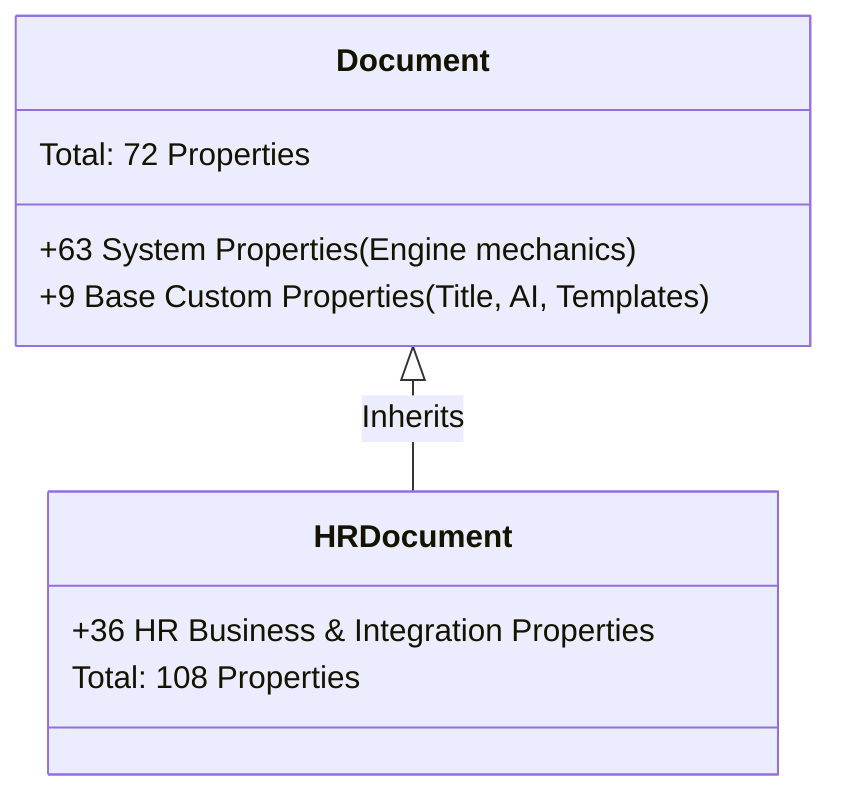

## 📋 The Situation

A business analyst in the room asks: *"Why does HRDocument have 108 properties? That seems like a lot."* You ask Bob to explain the inheritance model.

## 💬 Prompt to Bob

1. Make sure **Ask Mode** is selected and enter the following prompt:

    ```
    Can you explain the relationship between the base Document class and 
    HRDocument? Why does HRDocument have so many properties? What does it 
    inherit and what does it add?
    ```

## ✅ Expected Output from Bob

Bob should provide an explaination similar to:

::: info

#### The Relationship Between `Document` and `HRDocument`

In IBM Content Services (FileNet), document classes follow an **object-oriented inheritance model**. `Document` is the **root base class** for all content in the repository, and `HRDocument` is a direct subclass of `Document`.



---

#### Why Does `HRDocument` Have 108 Properties?

`HRDocument` does not define 108 independent properties from scratch. Rather:
* **72 properties (67%)** are **inherited** directly from the base `Document` class.
* **36 properties (33%)** are **added** specifically for HR business data and enterprise integrations.

---

#### 1. What `HRDocument` Inherits from `Document` (72 Properties)

Every document in the repository requires underlying engine mechanics to support lifecycle management, access control, storage, and versioning.

* **63 System-Owned Properties:**
  * **Versioning:** `MajorVersionNumber`, `MinorVersionNumber`, `IsCurrentVersion`, `IsReserved`, `ReservationType`, `VersionSeries`, `VersionStatus`, etc.
  * **Security & Access Control:** `Permissions`, `Owner`, `SecurityPolicy`, `SecurityFolder`, `ActiveMarkings`.
  * **Storage & Content Engine:** `MimeType`, `ContentSize`, `StorageArea`, `StorageLocation`, `ContentRetentionDate`, `DateContentLastAccessed`.
  * **Audit & Lifecycle:** `Creator`, `DateCreated`, `LastModifier`, `DateLastModified`, `DateCheckedIn`, `CurrentState`, `IsInExceptionState`.
* **9 Base Custom Properties:**
  * Core identity: `DocumentTitle`
  * UI & Entry Templates: `EntryTemplateId`, `EntryTemplateObjectStoreName`, `EntryTemplateLaunchedWorkflowNumber`, `ComponentBindingLabel`, `IgnoreRedirect`, `ClbSecurityController`
  * AI & Search Integration: `GenaiDateIndexed`, `GenaiWatsonxSummary`

---

#### 2. What `HRDocument` Adds (36 Custom Properties)

`HRDocument` introduces 36 business properties tailored for employee records and cross-system automation:

| Functional Area | Count | Properties Added |
|---|:---:|---|
| **Employee Identification & Personal Data** | 5 | `FirstName`, `LastName`, `EmployeeID`, `PersonalID`, `Birthdate` |
| **Job & Organizational Structure** | 14 | `JobRole`, `JobFunction`, `JobCode`, `JobLevel`, `JobStatus`, `EmploymentType`, `CurrentStatus`, `Company`, `CompanyCode`, `BusinessUnit`, `Division`, `Department`, `CostCenter`, `Location` |
| **Employment Dates** | 2 | `StartDate`, `TerminationDate` |
| **SAP HR ArchiveLink Integration** | 8 | `SAPEmployeeID`, `SapLinkTrigger`, `sapLinked`, `SAPDocId`, `SAPDocProt`, `SAPComps`, `SAPContType`, `SAPCompVersion` |
| **Salesforce & Workflow Integration** | 4 | `SFLinkTrigger`, `SfSalesforceRelationships`, `docuflowTimestamp`, `docuflowUsername` |
| **Document Classification within HR** | 3 | `DocType`, `DocumentCategory`, `ClassDocType` |

---

#### Architectural Takeaway: Single Class vs. Subclass Proliferation

Notice the properties `DocType` and `DocumentCategory` on `HRDocument`. 

Instead of creating dozens of individual document classes for every type of HR record (e.g. `EmploymentContract`, `PaySlip`, `PerformanceReview`, `LeaveRequest`), the HR domain uses a **single class design** where `DocType` acts as a discriminator. This avoids schema sprawl while giving all HR documents access to employee metadata and ERP integration flags.

:::

## 💡 The "Class vs Property" Design Decision

This is a fundamental design question: *"Should I create a new class, or add a property to an existing class?"*

### Create a new class when:
- The document type has fundamentally different properties
- Different security policies apply
- Different lifecycle/retention rules apply
- Different workflows are triggered

### Add a property when:
- The document type is a variant of an existing type
- The same properties apply, just with different values
- You want to avoid class proliferation

In case you find a lot of duplicate classes in your repository this is largely caused by teams choosing *"Create a new class"* when they also chould have added a property to a matching existing class.