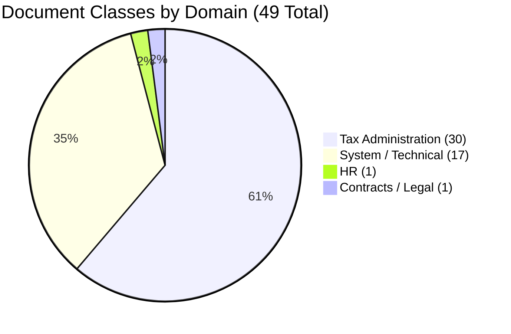

## 📋 The Situation

You've seen the inventory, the duplicates, the legacy classes, and the inheritance model. Now you want Bob to synthesize everything into a prioritized action plan.

## 💬 Prompt to Bob

1. Make sure **Plan Mode** is selected and enter the following prompt:

  ```
  Help me create a cleaning plan based on everything you've seen in our
  repository — the duplicates, the legacy classes, the naming inconsistencies.
  Include a prioritized roadmap with quick wins and longer-term actions. 
  Create a Markdown with that plan. Do not execute the plan.
  ```

## ✅ Expected Output from Bob

Bob should produce a structured roadmap similar to:

::: info

#### Repository Cleanup Roadmap & Architecture Plan

#### Executive Summary

- **Scope:** Complete analysis of 49 repository document classes (30 Tax Administration, 1 HR, 1 Contracts/Legal, 17 System/Technical).
- **Primary Objective:** Eliminate redundant classes, resolve generic vs. specialized hierarchy conflicts, standardize naming conventions, and establish governance.
- **Estimated Timeline:** 12-Week Phased Implementation.

---

#### Current State Assessment



##### Key Issues Identified
1. **Direct Duplicates & Frequency Proliferation:** Classes created for specific reporting periods (e.g., `AangifteBTWKwartaal`) or amendment states (`CorrectieAangifteLoonheffingen`).
2. **Customs Hierarchy Overlap:** Generic `Douaneaangifte` coexists alongside specific import, export, and simplified declaration classes.
3. **Domain Granularity Imbalance:** 30 hyper-specific tax classes vs. single catch-all classes for HR (`HRDocument` with 108 properties) and Contracts (`Contract`).
4. **Naming Inconsistencies:** Mixture of abbreviations (`VoorlopigAanslagIB`, `AangifteBPM`) and full words (`VoortaxatieVennootschapsbelasting`).

---

#### 12-Week Roadmap Overview

| Phase | Focus Area | Timeline | Target Reduction / Enhancement | Risk Level |
|---|---|---|---|:---:|
| **Phase 1** | Quick Wins: Obvious Duplicate Consolidation | Weeks 1–3 | 49 → 46 Classes | Low |
| **Phase 2** | Customs & Financial Statements Alignment | Weeks 4–6 | 46 → 44 Classes | Medium |
| **Phase 3** | Choice Lists & Metadata Standardization | Weeks 7–8 | Standardize 80%+ Key Properties | Low |
| **Phase 4** | HR & Contract Domain Evaluation | Weeks 9–10 | Formalize Subtype/Classification Strategy | Low |
| **Phase 5** | Governance, Retention & Auditing | Weeks 11–12 | Continuous Policy Enforcement | Low |

---

#### Phase Details

---

##### Phase 1: Quick Wins (Weeks 1–3)
**Objective:** Merge classes that represent pure status/frequency variants into their primary parent classes.

* **Action 1.1: VAT Quarterly Filing Consolidation**
  * Merge `AangifteBTWKwartaal` → `AangifteBTW`.
  * Add/verify `FilingPeriod` choice list (`Maand`, `Kwartaal`, `Jaar`) on `AangifteBTW`.
* **Action 1.2: Payroll Tax Correction Consolidation**
  * Merge `CorrectieAangifteLoonheffingen` → `AangifteLoonheffingen`.
  * Add `IsCorrection` boolean property.
* **Action 1.3: Corporate Preliminary Assessment Consolidation**
  * Merge `VoortaxatieVennootschapsbelasting` → `AangifteVennootschapsbelasting`.
  * Add `AssessmentType` choice list (`Voorlopig`, `Definitief`).

---

##### Phase 2: Customs & Financial Reporting Alignment (Weeks 4–6)
**Objective:** Resolve coexistence of generic parent classes with specialized filing subtypes.

* **Action 2.1: Customs Declarations Architecture**
  * Evaluate `Douaneaangifte` vs. `InvoerAangifte`, `UitvoerAangifte`, and `VereenvoudigdeDouaneaangifte`.
  * Standardize on `Douaneaangifte` with a mandatory `CustomsProcedure` choice list, or officially deprecate the generic class in favor of specialized subclasses.
* **Action 2.2: P&L Statement Consolidation**
  * Review standalone `WinstEnVerliesrekening` filings.
  * Integrate P&L documents into `JaarrekeningDocument` using a `FinancialStatementComponent` property.

---

##### Phase 3: Choice Lists & Metadata Standardization (Weeks 7–8)
**Objective:** Enforce data quality and resolve naming drift.

* **Action 3.1: Naming & Symbolic Name Alignment**
  * Standardize abbreviations across tax classes (documenting legacy aliases for `VoorlopigAanslagIB`).
* **Action 3.2: Choice List Deployment**
  * Implement strict choice lists for core HR properties (`JobStatus`, `EmploymentType`, `CurrentStatus`, `DocType`).
  * Ensure consistent property template usage across the object store.

---

##### Phase 4: HR & Contract Domain Architecture (Weeks 9–10)
**Objective:** Verify that the single-class discriminator model satisfies compliance and retention requirements.

* **Action 4.1: HR Retention & Security Review**
  * Validate that using `DocType` within `HRDocument` meets GDPR and retention schedule requirements.
  * If different document types require strict separate lifecycle policies (e.g., recruitment vs. disciplinary), define specialized subclasses.
* **Action 4.2: Contracts Schema Enrichment**
  * Add contract metadata properties (`ContractType`, `Counterparty`, `EffectiveDate`, `ExpirationDate`) to `Contract`.

---

##### Phase 5: Ongoing Governance & Automation (Weeks 11–12)
**Objective:** Prevent future class proliferation.

* **Action 5.1: Class Creation Gatekeeping**
  * Mandate architectural approval before any new Document subclass is created.
  * Enforce the rule: *Use properties/choice lists for variations; reserve classes for distinct schemas or lifecycles.*
* **Action 5.2: Automated Repository Audits**
  * Schedule quarterly health checks to detect unindexed classes, orphaned documents, and schema drift.

---

#### Action Matrix Summary

| Deprecated / Source Class | Target / Surviving Class | Strategy | Risk |
|---|---|---|:---:|
| `AangifteBTWKwartaal` | `AangifteBTW` | Add `FilingPeriod` property | Low |
| `CorrectieAangifteLoonheffingen` | `AangifteLoonheffingen` | Add `IsCorrection` flag | Low |
| `VoortaxatieVennootschapsbelasting` | `AangifteVennootschapsbelasting` | Add `AssessmentType` property | Low |
| `VereenvoudigdeDouaneaangifte` | `Douaneaangifte` | Add `DeclarationType` choice list | Medium |
| `WinstEnVerliesrekening` | `JaarrekeningDocument` | Add `DocumentComponent` property | Low |

:::

::: warning Why a 12-week estimate?
The 12-week schedule reflects traditional manual enterprise content governance. In production environments, administrators typically need to manually audit classes, write and test custom migration scripts, regression-test downstream integrations (such as SAP ArchiveLink and Salesforce), normalize legacy data for choice lists, and navigate standard multi-week enterprise release cadences.

**How IBM Bob and MCP automation could reduce this timeline:**
By combining AI assistance with deterministic MCP tools, many labor-intensive phases could be significantly streamlined:
- **Instant Schema & Property Diffing:** Bob can compare property templates, types, and constraints across candidate classes in seconds via `get_class_property_descriptions`.
- **Automated Batch Migration Scripts:** Rather than hand-coding migration utilities, Bob could generate and pre-validate idempotent GraphQL/MCP operations (`update_document_class`, `update_document_properties`) for document reclassification.
- **Data Normalization:** Bob can analyze legacy property value patterns to assist in building standardization maps for new choice lists.
- **Automated Verification:** Automated pre- and post-migration checks could confirm that document counts and property values remain intact, helping reduce manual verification effort and migration risks.

*Depending on an organization's internal change approval processes, testing requirements, and integration complexity, leveraging these automations might substantially shorten the overall execution timeline.*
:::

## 💡 The Governance Lesson

Bob's roadmap mirrors what Content Cortex administrators would produce manually — but Bob derived it **from the live repository**, not from a static document or prior knowledge. The recommendations reflect the current state of the system at the moment you asked.

## 🏁 Lab Summary

In this lab, Bob helped you to:

| What Bob Did | MCP Tool Used |
|-------------|--------------|
| Inventoried all document classes | `list_root_classes` + `determine_class` |
| Identified duplicates and legacy classes | `get_class_property_descriptions` (comparative) |
| Deep-dived into the HRDocument document class | `get_class_property_descriptions HRDocument` |
| Explained the inheritance model | AI reasoning on property metadata |
| Produced a prioritized cleaning roadmap | AI synthesis of all findings |

## 💡 Key Insights

- **Bob can interrogate a live repository** — no need to navigate admin consoles or read static documentation
- **The "class vs property" design decision** is the root cause of class proliferation
- **HRDocument is well-designed** — it uses `DocType` to differentiate document types rather than creating separate classes
- **Governance is the long-term solution** — not just a one-time cleanup

## ➡️ Next Step

In the next lab, you'll generate 55 realistic HR documents and upload them to the repository using Bob — with a few deliberate mistakes that you'll fix in the last lab.